# Easy Radius user guide

This is the day-to-day guide for the person who runs the page. The pictures use sample names only: site `ExampleSite`, addresses in `192.0.2.0/24`, and passwords such as `example-password`. Nothing in these pictures is from a live network.

There is no separate dashboard. After you log in, the site opens on **Routers**. That page is also where router health is shown.

Open the site at `http://<server>:8088`. The username is `neill`. The password is printed once when the container starts (`sudo docker logs radius-admin`).

## 01_login.png

**Login**

This is the front door. Nothing else on the site can be opened until this succeeds.

1. Open `http://<server>:8088`.
2. Type `neill`.
3. Type the admin password.
4. Click **Log in**.

If authenticator codes are turned on, the same page then asks for a 6-digit code. See `02_login_2fa.png`.

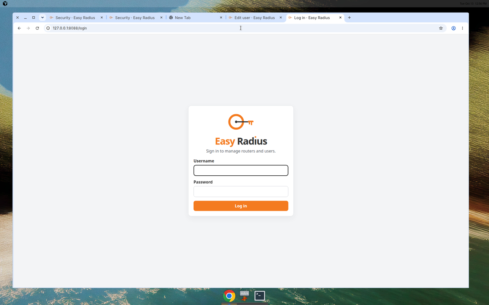

## 02_login_2fa.png

**Authenticator code at login**

This appears only after the password is correct and authenticator codes are on. It is the second step, not a replacement for the password.

1. Enter the username and password as usual and click **Log in**.
2. The page asks for the code from your authenticator app.
3. Type the current 6-digit code.
4. Enter the username and password again on that same form (the page asks for them together with the code) and click **Log in**.

A wrong code stays on this page. After too many wrong codes, sign in from the start again.


## 03_routers_health.png

**Routers, and router health**

This is the home page. Each row is one MikroTik (or other NAS) that is allowed to ask FreeRADIUS for a login. The coloured dot is health.

- **Up** (green) means a RADIUS packet from that router was seen in the last 15 minutes.
- **Down** (red) means nothing has been seen in that time, or nothing has been seen yet. Down does not by itself mean the router is broken. It means this server has not heard from it recently.

1. Read **This server's address**. That address is what you put in the MikroTik `/radius` command. Change it if it is wrong, then click **Save**. It does not change FreeRADIUS until you use it in those commands.
2. Use **Show** to reveal a shared secret. Click **Hide** when you are done.
3. **Edit** changes the site, address, secret, or tags.
4. **Disable** keeps the row but leaves that router out of the next Apply. **Enable** puts it back. Nothing reaches FreeRADIUS until you click **Apply**.
5. **Copy MikroTik config** shows the RouterOS lines for that row, including `src-address` set to that router's IP. See `06_mikrotik_config.png`.
6. **Add router** is for a new site.

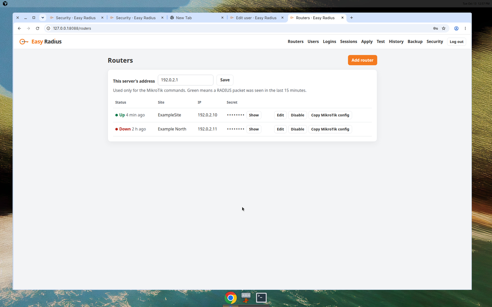

## 04_router_add.png

**Add router**

Use this when a new site should be allowed to authenticate against this server.

1. Click **Add router**.
2. Type the site name, for example `ExampleSite`.
3. Type the router address that this server will see, for example `192.0.2.10`.
4. A secret is filled in for you. You can replace it before saving. Use the same secret on the MikroTik.
5. Tags are optional. A tag such as `North` is a site group. You can later allow a user onto every router with that tag.
6. Click **Save**.
7. Click **Apply** before the router can actually log in.


## 05_router_edit.png

**Edit router**

Same fields as add. Use it when a site is renamed, renumbered, or its secret is rotated.

1. On **Routers**, click **Edit** on the row.
2. Change the site name, address, secret, or tags.
3. Click **Save**.
4. Click **Apply** so FreeRADIUS picks up the change.

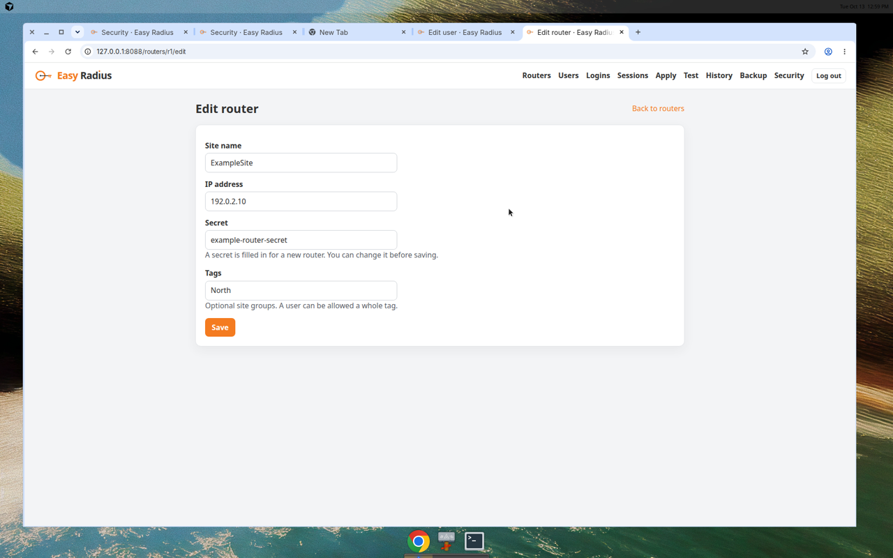

## 06_mikrotik_config.png

**Copy MikroTik config**

These lines are what you paste on the router. They stay hidden until you click, because they contain the shared secret. `src-address` is the router IP stored in Easy Radius. That IP must be an address the router itself owns. Without `src-address`, a router behind NAT can send from a public address FreeRADIUS does not know, and the packet is ignored.

1. On **Routers**, set **This server's address** and click **Save** if it is empty.
2. On the router row, click **Copy MikroTik config**.
3. The browser copies the commands, and these lines appear:
   - `/radius add address=<this server> secret=<that router's secret> service=login src-address=<router IP> timeout=3s`
   - `/radius set [find address=<this server>] src-address=<router IP> secret=<that router's secret>`
   - `/user aaa set use-radius=yes`
4. Paste the first line on a router that does not yet have this server. Paste the second if `/radius` already lists it. Paste the third so logins use RADIUS.
5. Click **Hide MikroTik config** when you are finished.

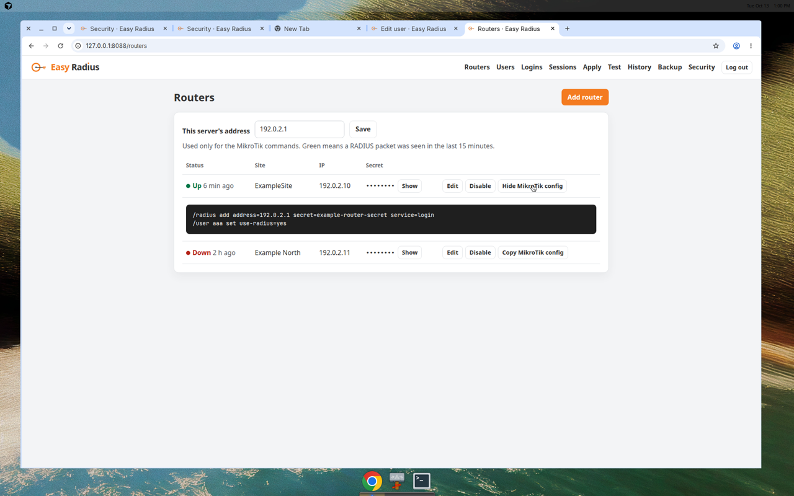

## 07_users.png

**Users**

These are the people who log in through RADIUS. The group becomes `Mikrotik-Group` (`full`, `write`, or `read`). The Access column says **All routers**, or the routers and site groups that person is limited to. The password is stored only as hashes. The page cannot show it. PAP (SSH login and the Test page) uses a SHA-512 hash. Winbox uses MS-CHAPv2, which needs a second hash, the NT hash. On an upgrade, an existing plaintext password is turned into both hashes. A password that was saved as only the SHA-512 hash cannot be converted. That row shows **Set password again to enable Winbox/MS-CHAP**. Set the password again, then click **Apply**.

1. **Add user** creates someone new.
2. **Set new password** opens the edit page so you can replace the password. Leave that box blank to keep the current one. **Edit** changes the name, group, or access.
3. **Disable** keeps the person in the list but removes them from FreeRADIUS on the next Apply. **Enable** puts them back.
4. Click **Apply** after any of those changes.

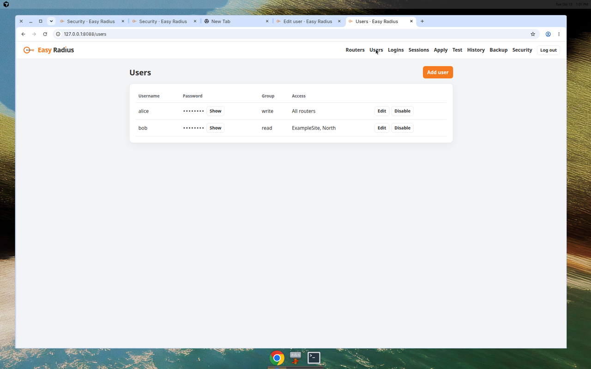

## 08_user_add.png

**Add user**

1. Click **Add user**.
2. Type a username and a password. The password is saved only as a hash. You cannot open this page later and read it back.
3. Choose the group: `full`, `write`, or `read`.
4. Leave **All routers** selected unless this person should be limited.
5. Click **Save**, then **Apply**.

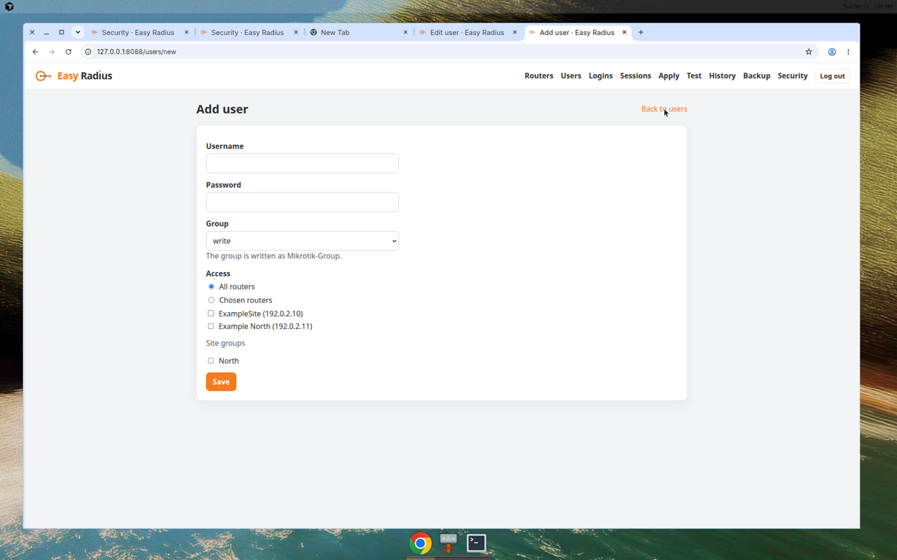

## 09_user_edit_access.png

**Edit user, including which routers they may use**

**All routers** is the default. **Chosen routers** rejects this person on every router you did not tick, and on every router that does not carry a ticked site group.

1. Click **Edit** on the user. The password box is empty. Type a new password only when you want to replace the old one.
2. Choose **Chosen routers**.
3. Tick the routers they may use.
4. Tick a site group, such as `North`, to include every router with that tag.
5. Click **Save**, then **Apply**.

If you choose **Chosen routers** and tick nothing, that person is rejected everywhere. A disabled router is not an active path until you enable it and Apply.

On the Test page, pick one of their routers. A test that does not name an allowed router is rejected, which is the same rule the live routers follow.

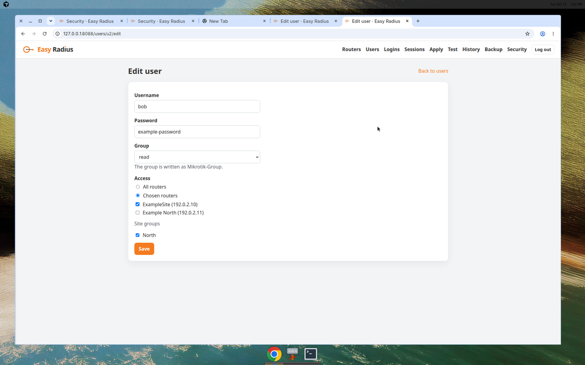

## 10_apply_success.png

**Apply, when the check passes**

Apply is the only button that changes the running FreeRADIUS config. Saving a form only stores it in this app.

1. Click **Apply** in the top bar.
2. Click **Apply to FreeRADIUS**.
3. The page backs up `clients.conf`, the users file, and the access policy, writes the new files, and runs `freeradius -XC`.
4. A green line, **Check passed and FreeRADIUS was restarted**, means the service is using the new files.
5. The dark box is the full output. Read it if something looks wrong later.
6. A successful Apply is also stored under **History** so you can roll back to it.

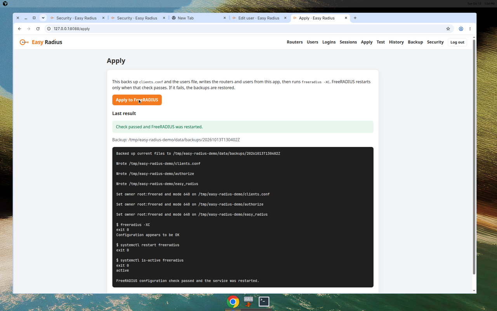

## 11_apply_fail.png

**Apply, when the check fails**

If `freeradius -XC` fails, FreeRADIUS is not restarted and the previous files are put back. The routers and users you saved in the page are still there. Fix the problem and Apply again.

1. Click **Apply to FreeRADIUS**.
2. A red line, **Apply did not complete. Previous files were restored**, means the running service was left on the last good config.
3. Read the dark box. The `freeradius -XC` section is the reason.
4. Correct the router or user that caused it, then Apply again.

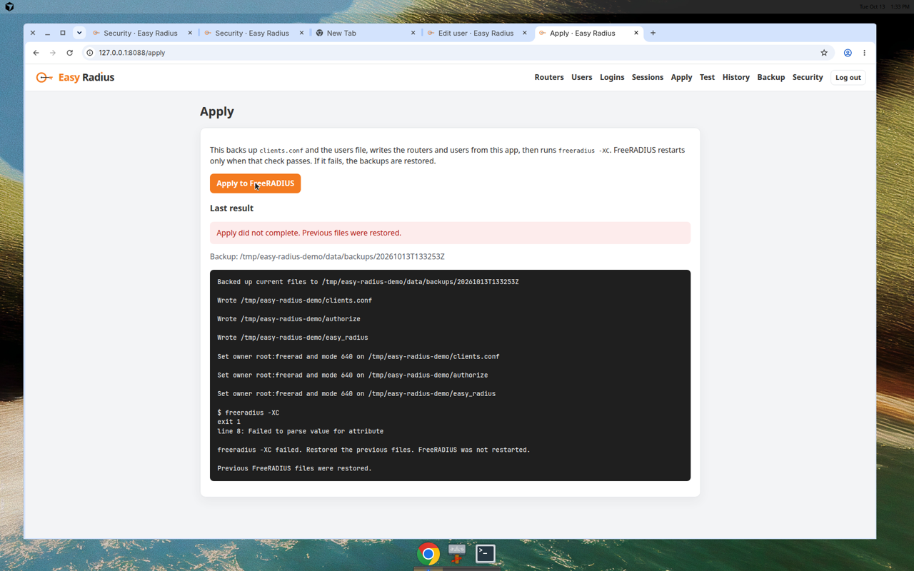

## 12_test_login.png

**Test login**

This runs `radtest` on the server, against localhost, using the localhost client secret. It checks that FreeRADIUS will accept a user. Apply first, or the test is still talking to the old config.

1. Click **Test**.
2. Type the username and password. This is PAP, the same method an SSH login uses. Winbox uses MS-CHAP instead, which FreeRADIUS checks with the NT hash stored beside the PAP hash.
3. For someone allowed on all routers, **This server only** is enough.
4. For someone limited to chosen routers, pick one of those routers in the **Router** list. The test sets `NAS-IP-Address` to that router.
5. Click **Run test**.
6. **Access-Accept** means FreeRADIUS accepted them. **Access-Reject** means it did not. A limited user tested against the wrong router is rejected with `Not allowed on this router`.

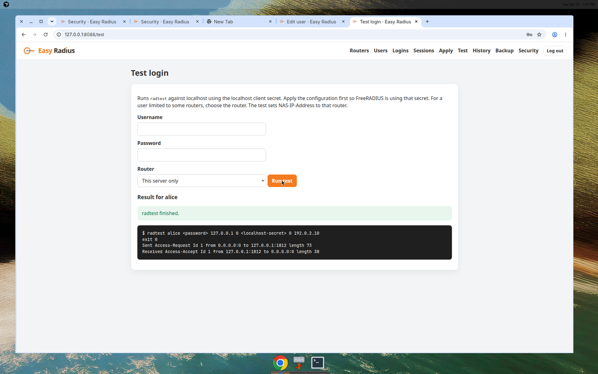

## 13_login_log.png

**Login log**

Recent Access-Accept and Access-Reject lines, from `/var/log/freeradius/easy-radius-auth.log`. The installer turns this logging on.

1. Click **Logins**.
2. Filter by router, by part of a username, or by Accept / Reject.
3. Click **Filter**.
4. **All** in every box clears the filter.

Green is Accept. Red is Reject.

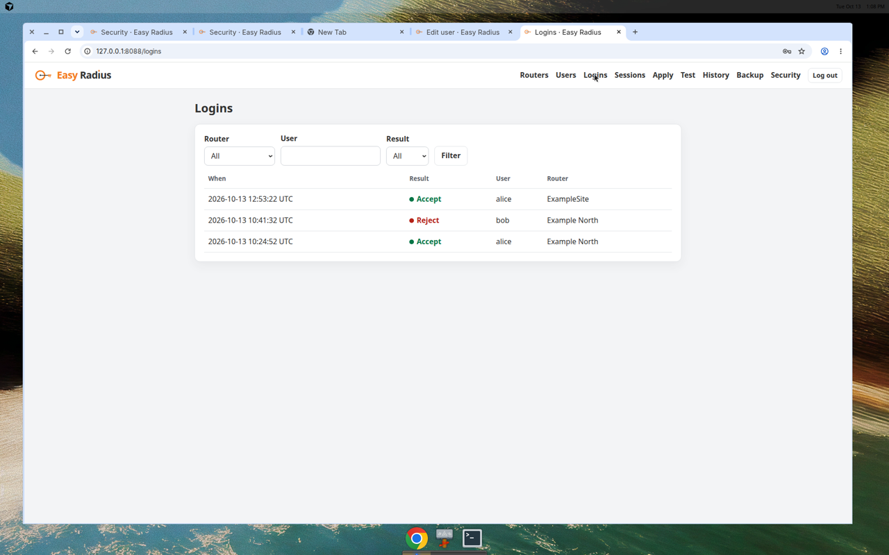

## 14_sessions.png

**Accounting and who is online**

This reads `/var/log/freeradius/easy-radius-acct.log`.

1. Click **Sessions**.
2. **Logged in now** is anyone with a Start and no later Stop.
3. **Recent accounting** is the Start, update, and Stop history, newest first.

A router that does not send accounting will not appear here, even if login works.


## 15_history.png

**Change history**

Who changed what, and when. The user is `neill`, because that is the only admin login. Below that, each successful Apply is a snapshot.

1. Click **History**.
2. Read the change list when you need to see what was edited.
3. Use a snapshot's **Roll back** when you want the routers and users from that Apply put back and written to FreeRADIUS.


## 16_rollback_confirm.png

**Roll back confirmation**

Rolling back replaces the current routers and users and runs Apply. The browser asks before it does that.

1. On **History**, click **Roll back** on the snapshot you want.
2. Read the time in the question.
3. Click **Cancel** to leave things as they are.
4. Click **OK** to restore that snapshot and apply it.
5. If FreeRADIUS rejects the snapshot, nothing is kept and the Apply page shows the error.

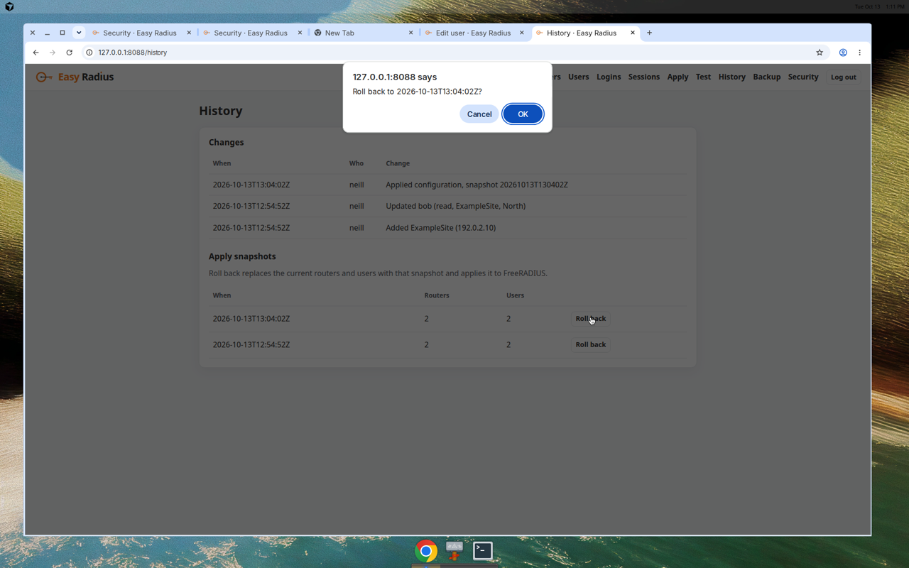

## 17_backup.png

**Backup download and restore**

One file holds the routers, user password hashes, localhost secret, authenticator setup, and the admin password hash. It is encrypted with a passphrase you choose. Easy Radius does not store that passphrase. Lose the passphrase and the file cannot be opened. An older backup that still contains a plaintext user password is hashed when you restore it, before it is written to disk.

Download:

1. Click **Backup**.
2. Type a passphrase of at least 8 characters.
3. Click **Download backup**.
4. Keep the file somewhere safe, off this server if you can.

Restore:

1. Choose the backup file.
2. Type the same passphrase.
3. Click **Restore**.
4. The browser asks **Replace the current Easy Radius data with this backup?** Cancel if you are not sure.
5. After a restore, click **Apply** so FreeRADIUS matches the restored list.
6. The admin password may also change to whatever it was when the backup was made.

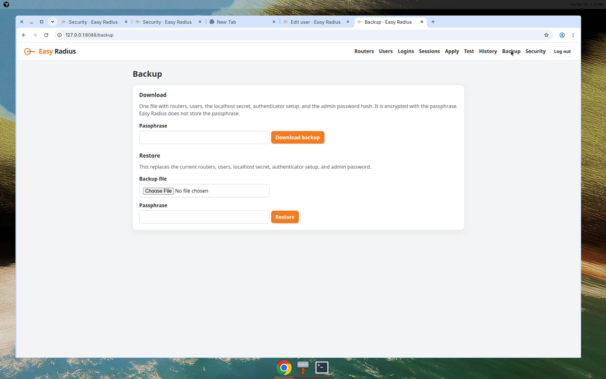

## 18_security_off.png

**Security, authenticator codes off**

This is the setting for a second step at login. Leave it off if a password is enough.

1. Click **Security**.
2. If you want codes, click **Set up authenticator** and follow `19_security_setup.png`.

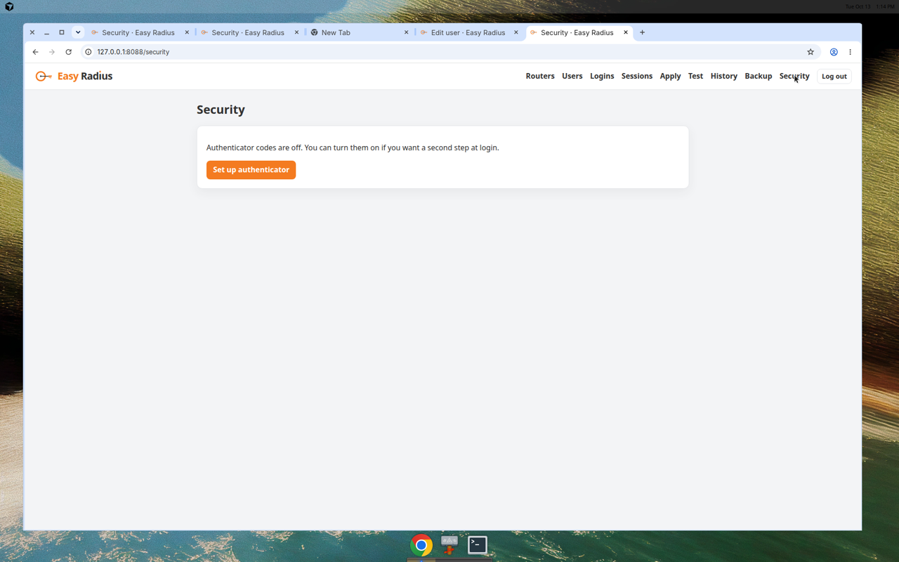

## 19_security_setup.png

**Security, setting up authenticator codes**

The real page generates a new secret when you click **Set up authenticator**. The picture uses the published RFC 6238 test secret so this guide does not contain a live authenticator secret. On your server, treat the secret on this page like a password. Do not leave it on a shared screen.

1. Click **Set up authenticator**.
2. Add the secret to an authenticator app (or open the `otpauth://` link on your phone).
3. Type the 6-digit code the app shows.
4. Click **Turn on**.
5. The next time you log in, the page asks for a code as well as the password.


## 20_security_on.png

**Security, authenticator codes on**

Use this to turn the second step back off.

1. Open **Security**.
2. Type the current 6-digit code.
3. Click **Turn off authenticator codes**.
4. The next login is username and password only.

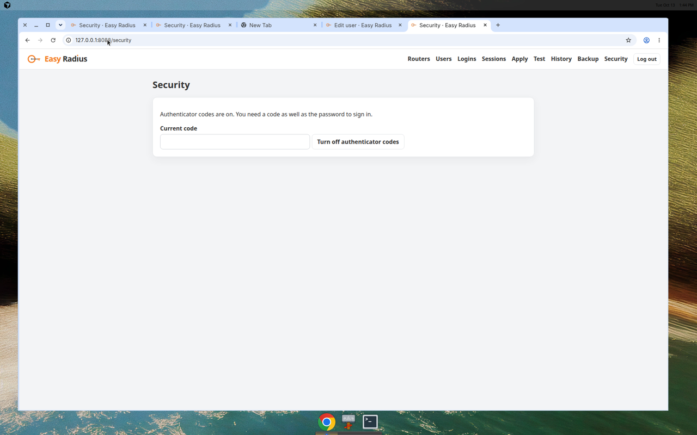

## Change the admin password

Use this when you still know the current password. The new one must be at least 12 characters. It is stored only as a hash. Other browsers that were signed in are signed out. This browser stays signed in.

1. Click **Security**.
2. Type the current password.
3. Type the new password twice.
4. Click **Change password**.

If you have forgotten the password, on the server run:

```bash
sudo docker exec -it radius-admin python -m easy_radius.reset_admin_password
```

It asks for the new password twice and does not print it.

## Automation

**Change many routers from one page**

Automation logs into the routers you already keep in Easy Radius and sets a short list of RouterOS values. It does not use Ansible. The router list and the site groups (tags such as `North`) are the only inventory.

On each MikroTik, before you run a task:

1. Turn on API-SSL: `/ip service enable api-ssl`
2. Let only this Easy Radius server in: `/ip service set api-ssl address=<this server>/32`
3. API-SSL listens on port **8729**. If that port does not answer, Easy Radius tries the plaintext API on port **8728**. Prefer 8729. The router's certificate is usually self-signed, and Easy Radius accepts that.
4. The router must already send logins to this RADIUS server (the lines under **Copy MikroTik config**, including `use-radius=yes`).
5. SSH is not required for a task. `/export` is read over the API.

On the Automation page:

1. Save a **service account**. This is a RADIUS user Easy Radius uses to log into the API. Create one (group `write` or `full`) or pick an existing user and type the password again. The password is encrypted and is not shown after you save it. You can generate one instead of typing it.
2. Click **Apply** so FreeRADIUS learns that user. Until you do, the router cannot authenticate the account.
3. A `read` user can be used for Check, but Run will be refused by the router.
4. Open a task. The built-in examples set NTP, DNS, identity, and SNMP. Edit the example addresses before you use them. You can also write a task as lines such as `/ip/dns set servers=192.0.2.53 allow-remote-requests=no`, or upload YAML or JSON.
5. Click **Run** on the task. Tick routers, or a site group, or both. Disabled routers are left out.
6. Click **Check** first. It reads the current values and shows what would change. It does not write.
7. Click **Run** to write only the values that differ. If you selected more than one router, tick the confirmation and accept the question in the browser.
8. **Routers at a time** is the batch size. Those routers are contacted together. If one fails, later batches do not start, and routers that had not started are marked skipped.
9. Before it changes a router, Run saves that router's `/export`. Open **View /export** on the result. Secrets are hidden in a normal export, so **Restore** cannot put passwords back. Restore asks you to confirm, then sends the saved text to that router.
10. The result for each router (ok, changed, failed, or skipped) is on the run page and under **History**, with your admin name on the row.

The service-account password is not written into a task, a run, or History.
